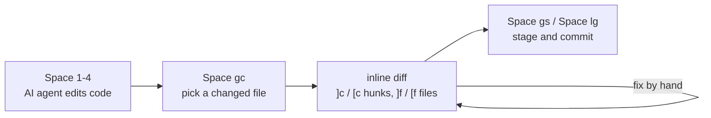
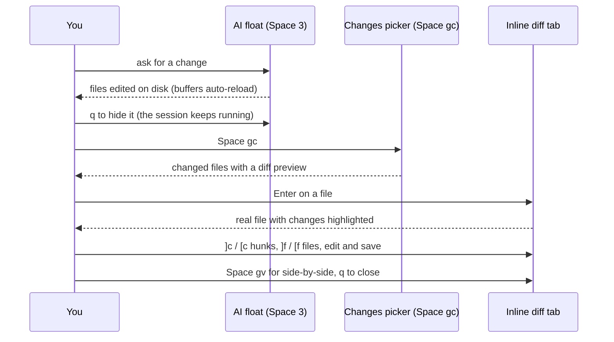
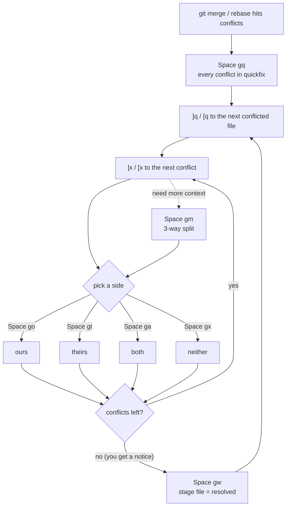
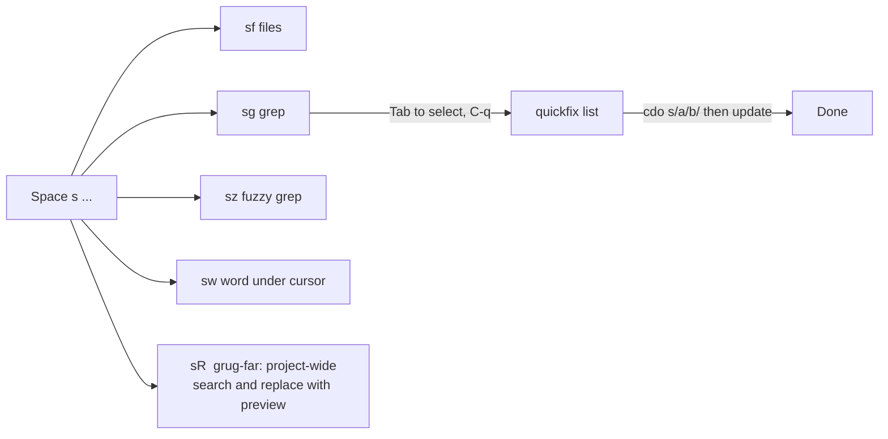
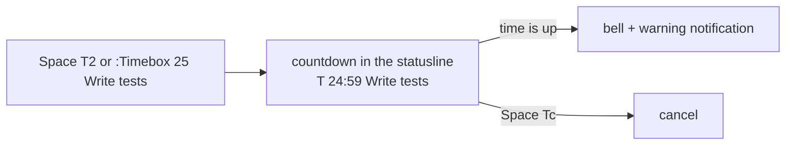
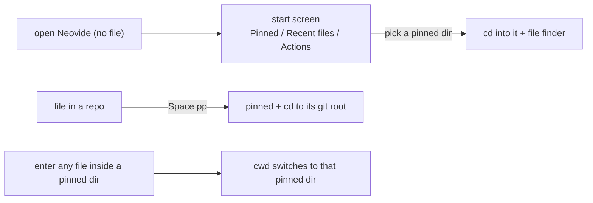

# nvim-11-stable-conf

A personal, **text-only** Neovim config built on
[kickstart.nvim](https://github.com/nvim-lua/kickstart.nvim) for the latest
stable Neovim (**>= 0.12**). It is built around one workflow: let AI agents
edit code in floating terminals, then **review, fix and merge** their changes
without leaving the editor.

- No Nerd Font, no icons: everything renders as plain text.
- Starts in about 85 ms. Heavy plugins load only when you open a file or
  press their key.
- Space is `<leader>`. Press it and wait: which-key shows every
  binding in a side panel.

---

## Contents

1. [Install](#install)
2. [The 30-second tour](#the-30-second-tour)
3. [Keymap cheat sheet](#keymap-cheat-sheet)
4. [Workflows](#workflows)
   - [Run an AI agent and review its changes](#1-run-an-ai-agent-and-review-its-changes)
   - [Resolve merge conflicts](#2-resolve-merge-conflicts)
   - [Find files, grep and replace](#3-find-files-grep-and-replace)
   - [Everyday git](#4-everyday-git)
   - [Code intelligence (LSP)](#5-code-intelligence-lsp)
   - [Tasks and builds](#6-tasks-and-builds)
   - [Timebox yourself](#7-timebox-yourself)
   - [Pin projects and switch between them](#8-pin-projects-and-switch-between-them)
5. [What you see on screen](#what-you-see-on-screen)
6. [Languages and tooling](#languages-and-tooling)
7. [Editor behaviour](#editor-behaviour)
8. [Layout of this repo](#layout-of-this-repo)
9. [Maintenance commands](#maintenance-commands)

---

## Install

**Requirements:**
- [Neovim](https://neovim.io/) >= 0.12
- git
- a C compiler and the
  [`tree-sitter` CLI](https://github.com/tree-sitter/tree-sitter) (for parsers)

**Optional CLIs:**
- `lazygit`
- the AI TUIs: `cursor-agent`, `opencode`, `claude`, `codex`

```bash
# Linux / macOS
git clone git@github.com:prerit714/nvim-11-stable-conf.git ~/.config/nvim

# Windows (PowerShell)
git clone git@github.com:prerit714/nvim-11-stable-conf.git $env:LOCALAPPDATA\nvim
```

Start `nvim`: lazy.nvim installs itself and every plugin. Mason then
installs the language servers, formatters and linters in the background.

---

## The 30-second tour

```
 <Space>            which-key panel: every binding, grouped
 <Space><Space>     switch buffer          <Space>sf  find file
 <Space>sg          live grep              <Space>o   file explorer (oil)
 <Space>3           Claude in a float      <Space>gc  review uncommitted changes
 <Space>gq          list merge conflicts   <Space>lg  lazygit
 jk / kj            leave insert mode      <Esc>      clear search highlight
```



---

## Keymap cheat sheet

`<leader>` = **Space**. Groups match the which-key panel.

### Core

| Key | Mode | Action |
|---|---|---|
| `jk` / `kj` | insert | Leave insert mode |
| `<Esc>` | normal | Clear search highlight |
| `<C-h/j/k/l>` | normal | Move between splits |
| `<Esc><Esc>` | terminal | Leave terminal mode |
| `<leader>q` | normal | Diagnostics to the location list |
| `<leader>d` | normal | Show the diagnostic under the cursor |
| `<leader>bf` | normal/visual | Format buffer (format-on-save is **off**) |
| `<leader>tw` | normal | Toggle line wrap |
| `<leader>th` | normal | Toggle LSP inlay hints |
| `<leader>tc` | normal | Toggle treesitter context (sticky scope header) |
| `<leader>tb` | normal | Toggle inline git blame for the current line |
| `<leader>tD` | normal | Toggle showing deleted lines inline (gitsigns) |

### Search `<leader>s`

| Key | Action | Engine |
|---|---|---|
| `<leader>sf` | Find files (frecency ranked) | fff |
| `<leader>sg` | Live grep | fff |
| `<leader>sz` | Fuzzy live grep | fff |
| `<leader>sw` | Grep the word under the cursor | fff |
| `<leader>sn` | Find files in the Neovim config | fff |
| `<leader><leader>` | Switch between open buffers | fff + ui-select |
| `<leader>s.` | Recently opened files | telescope |
| `<leader>sh` | Help tags | telescope |
| `<leader>sk` | Keymaps | telescope |
| `<leader>sd` | Diagnostics | telescope |
| `<leader>sr` | Resume the last picker | telescope |
| `<leader>ss` | List all telescope pickers | telescope |
| `<leader>/` | Fuzzy search in the current buffer | telescope |
| `<leader>s/` | Grep in open files | telescope |
| `<leader>sR` | Search and replace across the project (visual mode: the selection) | grug-far |

Inside an fff picker:
- `<CR>` opens the file.
- `<C-s>`, `<C-v>` and `<C-t>` open it in a split, a vertical split or a tab.
- `<Tab>` selects multiple files; `<C-q>` sends them to quickfix.
- `<C-u>` / `<C-d>` scroll the preview.

### Navigation

| Key | Action |
|---|---|
| `<leader>o` | oil.nvim: edit the directory like a buffer (`-` goes up) |
| `<leader>.` | Harpoon: tag the current file |
| `<leader>m` | Harpoon: quick menu |
| `H` / `L` | Harpoon: previous / next tagged file |
| `<leader>M` | loki.nvim: rendered read-only view of the markdown buffer (`:Loki [file]` from anywhere; `q` quits) |

### AI agents (floating terminals)

| Key | Opens |
|---|---|
| `<leader>1` | `cursor-agent` |
| `<leader>2` | `opencode` |
| `<leader>3` | `claude` |
| `<leader>4` | `codex` |

Each key toggles its own float, and the session keeps running while the float
is hidden. Inside a float:
- `<Esc><Esc>` leaves terminal mode.
- `q` (in normal mode) hides the float.

### Git `<leader>g` and hunks `<leader>h`

| Key | Action |
|---|---|
| `<leader>gc` | **Review uncommitted changes** (picker + inline diff) |
| `<leader>gC` | Review the whole branch (vs merge-base with main) |
| `<leader>gs` | Fugitive status (`s` stage, `u` unstage, `=` inline diff, `cc` commit) |
| `<leader>gd` | Vertical diff of the file vs the index |
| `<leader>gb` | Blame |
| `<leader>gl` | Log |
| `<leader>lg` | lazygit in a float |
| `]c` / `[c` | Next / previous hunk |
| `<leader>hs` / `<leader>hr` | Stage / reset hunk (also works on a visual selection) |
| `<leader>hS` / `<leader>hR` | Stage / reset the whole buffer |
| `<leader>hp` / `<leader>hb` | Preview hunk / blame line |
| `<leader>hd` / `<leader>hD` | Diff vs index / vs last commit |

### Merge conflicts

| Key | Action |
|---|---|
| `<leader>gq` | Every conflict in the repo, in the quickfix list |
| `<leader>gm` | 3-way split: ours, result, theirs |
| `]x` / `[x` | Next / previous conflict |
| `<leader>go` | Take **ours** |
| `<leader>gt` | Take **theirs** |
| `<leader>ga` | Take **both** (ours first) |
| `<leader>gx` | Take **neither** |
| `<leader>gw` | Stage the file (marks it resolved) |

### LSP (when a server is attached)

| Key | Action |
|---|---|
| `grd` | Go to definition |
| `grr` | References |
| `gri` | Implementations |
| `grt` | Type definition |
| `grD` | Declaration |
| `grn` | Rename |
| `gra` | Code action (normal and visual mode) |
| `gO` / `gW` | Document / workspace symbols |
| `K` | Hover docs (Neovim default) |
| `<C-s>` | Signature help in insert mode (Neovim default) |

### Completion (blink.cmp, default preset)

| Key | Action |
|---|---|
| `<C-space>` | Open the menu / toggle docs |
| `<C-n>` / `<C-p>` | Next / previous item |
| `<C-y>` | Accept |
| `<C-e>` | Close |
| `<Tab>` / `<S-Tab>` | Jump through snippet placeholders |

### Text objects and surround (mini.nvim)

| Key | Example | Meaning |
|---|---|---|
| `a` / `i` objects | `va)`, `yinq`, `ci'` | Around / inside, with next (`n`) and last (`l`) variants |
| `sa` | `saiw)` | **S**urround **a**dd: wrap a word in parentheses |
| `sd` | `sd'` | **S**urround **d**elete: remove the quotes |
| `sr` | `sr)'` | **S**urround **r**eplace: turn `)` into `'` |

### Tasks `<leader>O`

| Key | Action |
|---|---|
| `<leader>Or` / `<leader>OR` | Run a task / a shell command |
| `<leader>Ot` | Toggle the task list |
| `<leader>Oa` | Quick action on a task |
| `<leader>Ob` | Build a task |
| `<leader>Oi` | Overseer info |
| `<leader>Oc` | Clear the task cache |

### Timebox `<leader>T`

| Key | Action |
|---|---|
| `<leader>Ts` | Start a timer (asks for minutes, then a label) |
| `<leader>T5` / `<leader>T1` / `<leader>T2` | Start a 5 / 15 / 25 minute timer |
| `<leader>Tl` | List running timers |
| `<leader>Tc` | Cancel a timer (picker) |

Or use the command: `:Timebox 25 Write tests`, `:Timebox list`,
`:Timebox cancel`, `:Timebox cancel all`. Decimals work, e.g. `0.5`
for 30 seconds.

### Pinned dirs and start screen `<leader>p`

| Key | Action |
|---|---|
| `<leader>pp` | Pin the current project (and cd into it), or unpin it |
| `<leader>pl` | Pick a pinned dir: cd into it and open the file finder |
| `<leader>ps` | Open the start screen |

### Neovide only

| Key | Action |
|---|---|
| `<C-+>` / `<C-=>` | Zoom in |
| `<C-->` | Zoom out |

---

## Workflows

### 1. Run an AI agent and review its changes



**The picker** (`<leader>gc` for uncommitted changes, `<leader>gC` for the
whole branch, `:GitChanges <ref>` for any ref):

```
+- Git changes vs HEAD ---------------------+-- Diff -----------------------------+
| > _                                       | @@ -12,7 +12,9 @@                   |
|   M S  +12   -3  lua/options.lua          |  local x = 1                        |
| > M    +40   -8  lua/custom/view.lua      | -local y = 2                        |
|   ?    new       notes.txt                | +local y = 3                        |
|   D      +0  -19  LICENSE                 | +local z = 4                        |
+- <CR> diff  <C-e> edit  <C-s> stage/unstage                                     |
+-------------------------------------------+-------------------------------------+
  status: M modified  A added  D deleted  ? untracked     S = staged
```

**The inline diff view.** This is your real file, editable, and the
highlights update as you type:

```
 HEAD -> Working tree  lua/options.lua  [2/7]   ]f/[f files  ]c/[c hunks  <leader>gv split  q close
  10  vim.o.splitright = true
      vim.o.wrap = true                           <- red: removed line (virtual, not in the file)
  11  vim.o.wrap = false                          <- green: added / changed line
  12  vim.o.colorcolumn = "80"                    <- green
  13  vim.o.scrolloff = 10
```

Press `<leader>gv` to switch to the **side-by-side** layout (base version on
the left, read-only; your file on the right). `do` / `dp` and `]c` / `[c` work
there as in normal diff mode. The layout you pick is remembered.

> Buffers reload by themselves when an agent changes files on disk:
> `:checktime` runs on focus, buffer enter, cursor idle and terminal close.

### 2. Resolve merge conflicts



Conflicted files are coloured inline, with hints on the marker lines:

```
  <<<<<<< HEAD                               ours: <leader>go
  local timeout = 30                         <- green: ours
  ||||||| base                               base   (diff3 / zdiff3 style only)
  local timeout = 10                         <- red: common ancestor
  =======                                    both: <leader>ga | none: <leader>gx
  local timeout = 60                         <- blue: theirs
  >>>>>>> feature                            theirs: <leader>gt
```

`<leader>gm` opens fugitive's 3-way split:

```
+--------------------+--------------------+--------------------+
| ours (//2)         | working copy       | theirs (//3)       |
| HEAD's version     | <- edit this one   | incoming version   |
+--------------------+--------------------+--------------------+
```

The `<leader>go` / `gt` / `ga` / `gx` keys also work in the middle window.
On a diff block that has no conflict markers, `<leader>go` / `<leader>gt` fall
back to `:diffget //2` / `//3`. When you are done, `<leader>gw` stages the
file and fugitive closes the split.

### 3. Find files, grep and replace



- **fff** handles files and grep (fast, ranked by frecency, with a preview).
  **Telescope** covers everything else: help, keymaps, diagnostics, LSP
  pickers, and `vim.ui.select`.
- `<leader>sR` opens grug-far: type a search and a replacement, check the live
  preview, then apply.

### 4. Everyday git

```
 <Space>gs  fugitive status            <Space>lg  lazygit (full TUI in a float)
 ]c / [c    jump between hunks         <Space>hp  preview the hunk
 <Space>hs  stage the hunk             <Space>hr  reset the hunk
 <Space>tb  inline blame               <Space>gb  full blame window
```

The sign column shows `+` added, `~` changed and `_` deleted lines from
gitsigns.

### 5. Code intelligence (LSP)

Servers start when you open a matching file:

| Language | Server(s) |
|---|---|
| Lua | `lua_ls` |
| Python | `ty` (types), `ruff` (lint/format) |
| TS/JS | `vtsls` |
| CSS / Tailwind | `cssls`, `tailwindcss` |
| JSON / YAML | `jsonls`, `yamlls` with [SchemaStore](https://www.schemastore.org) schemas |
| Go | `gopls` |
| Rust | `rust_analyzer` |
| C/C++ | `clangd` |
| Java | `jdtls` via nvim-java (loads only for Java files) |

JSON and YAML files are checked against the matching schema from
schemastore.org: completion, hover docs and errors for `package.json`,
`tsconfig.json`, GitHub workflows, docker-compose, Kubernetes manifests and
more. The schema is matched by file name, or by a `"$schema"` key in the file.

Inlay hints are on where the server supports them; toggle them with
`<leader>th`. Diagnostics show as `E` / `W` / `I` / `H` in the sign column,
with virtual text.

### 6. Tasks and builds

`<leader>Or` lists the tasks overseer finds (make, npm scripts, cargo and so
on). `<leader>OR` runs any shell command, and `<leader>Ot` shows the running
and finished tasks.

### 7. Timebox yourself



You can run several timers at once. The statusline shows the one closest to
finishing, plus `+N` for the others. The timer code is not even loaded until
you start your first timer.

### 8. Pin projects and switch between them



`<leader>pp` pins the project you are in: the git root of the current file
(or its folder), the folder an Oil buffer shows, or the cwd on the start
screen. Press it again to unpin. Pins live in
`stdpath("data")/pinned_dirs.json`, so they survive restarts no matter where
Neovim was launched. Picking a pinned dir, or entering a file that lives inside
one, makes it the global cwd. fff, harpoon and telescope follow along. Files
outside every pinned dir leave the cwd alone, and so do windows with an
`:lcd`/`:tcd`. AI terminals (`<leader>1`-`4`) follow too: if the cwd changed
since a terminal started, toggling it restarts the CLI in the new folder (the
old session is closed).

---

## What you see on screen

```
+--------------------------------------------------------------------------------+
|  12 | function M.setup()             <- treesitter context header (<leader>tc) |
|-----+--------------------------------------------------------------------------|
| + 13|   local x = 1                    gitsigns column: + ~ _                  |
| ~ 14|   x = x + 1      |               indent guides (ibl), 80-col ruler       |
|E  15|   foo(           <- error: ...   diagnostics: sign + virtual text        |
+--------------------------------------------------------------------------------+
| NORMAL | main +1 ~2 E1 lua_ls | init.lua | utf-8 lua | 15:3 T 12:04 Tests 14:09:45 IST |
+--------------------------------------------------------------------------------+
   mode    git / diff / diagnostics / LSP     file          position  timebox   clock (IST)
```

- **Colour scheme:** gruvbox with a transparent background, so the terminal
  background shows through.
- **Statusline:** mini.statusline. The clock always shows **IST**
  (UTC+05:30), whatever the machine's timezone is, and refreshes every second.
- **Which-key:** the `helix` preset (a right-side panel) with no delay.

---

## Languages and tooling

| Language | Format (`<leader>bf`) | Lint | Indent |
|---|---|---|---|
| Lua | stylua | - | 2 spaces |
| Python | ruff (organize imports + format) | ruff (LSP) | 4 spaces |
| JS / TS / TSX | prettierd, prettier | eslint_d | 2 spaces |
| Go | goimports, gofmt | golangci-lint | tabs |
| Java | google-java-format | jdtls | 2 spaces |
| Rust | rust_analyzer (LSP) | rust_analyzer | 4 spaces |
| C / C++ | clangd (LSP) | clangd | 2 spaces |
| Markdown | mdformat | - | 4 spaces (rendered in normal mode) |
| HTML | superhtml | - | 2 spaces |
| JSON / YAML | jsonls / yamlls (LSP) | schema validation | 2 spaces |
| Groovy | npm-groovy-lint | - | 4 spaces |
| Make | - | - | tabs (no expand) |

Indentation is enforced per filetype in `lua/options.lua`, and guess-indent
handles everything else. Formatter and linter binaries are installed by Mason
(see the `ensure_installed` list in `lua/kickstart/plugins/lspconfig.lua`).

---

## Editor behaviour

- **Clipboard:** shares the system clipboard (`unnamedplus`).
- **Undo:** persistent undo history (`undofile`).
- **Search:** smart-case (`ignorecase` + `smartcase`). `:s` shows a live
  preview (`inccommand=split`).
- **Lines:** no soft wrap by default, an 80-column ruler, `scrolloff=10` and a
  highlighted cursor line.
- **Whitespace:** `>` for tab, `-` for trailing space, `+` for nbsp.
- **Splits:** new splits open to the right / below, and windows re-balance
  when the terminal is resized.
- **Diffs:** vertical by default, using the histogram algorithm, with
  character-level inline highlights.
- **Unsaved changes:** `:q` asks before discarding them (`confirm`).
- **External edits:** buffers reload by themselves when files change on disk.
- **Neovide:** uses `SauceCodePro NFM:h12`; zoom with `<C-+>` / `<C-->`.

---

## Layout of this repo

```
init.lua                    leader, transparency, then the modules below
lua/
  options.lua               options, filetype indents, auto-reload, diffopt
  keymaps.lua               core keymaps (jk, splits, wrap, Neovide zoom)
  lazy-bootstrap.lua        installs lazy.nvim
  lazy-plugins.lua          kickstart specs + { import = "custom.plugins" }
  kickstart/plugins/        LSP, completion, treesitter, gitsigns, which-key, ...
  custom/
    plugins/                one file per extra plugin (auto-imported)
    float_term.lua          shared floating-terminal launcher (AI TUIs)
    claude.lua, codex.lua,  one-line wrappers around float_term
    cursor_agent.lua, opencode.lua
    git_changes/            the <leader>gc reviewer (async git, picker, view)
    git_conflict.lua        conflict highlighting and resolution
    timebox.lua             countdown timers (:Timebox, <leader>T, statusline)
    pinned_dirs.lua         pinned projects, start-screen items, auto-cd
```

**To add a plugin:** drop a file returning a `LazySpec` into
`lua/custom/plugins/`. Put its keymaps in the spec's `keys = { ... }` so they
work before the plugin loads.

---

## Maintenance commands

```sh
nvim --headless "+qa"                 # smoke test: load the config, show errors
nvim --headless "+Lazy! sync" +qa     # install / update plugins
nvim --headless "+checkhealth" +qa    # health checks
stylua --check .                      # formatting (80 cols, 2 spaces)
nvim --startuptime /tmp/st.log +qa    # profile startup
```

`lazy-lock.json` is gitignored, so plugin versions float. Run `:Lazy` to see
what loaded and when.

---

MIT licensed. See [LICENSE](LICENSE). Inspired by
[kickstart.nvim](https://github.com/nvim-lua/kickstart.nvim).
